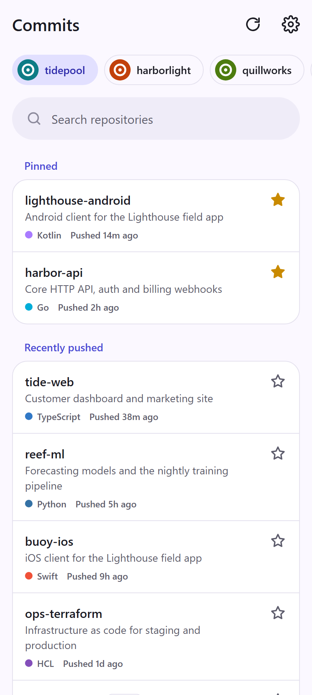
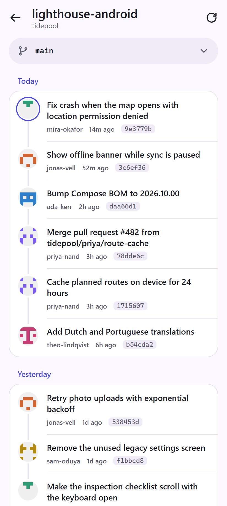
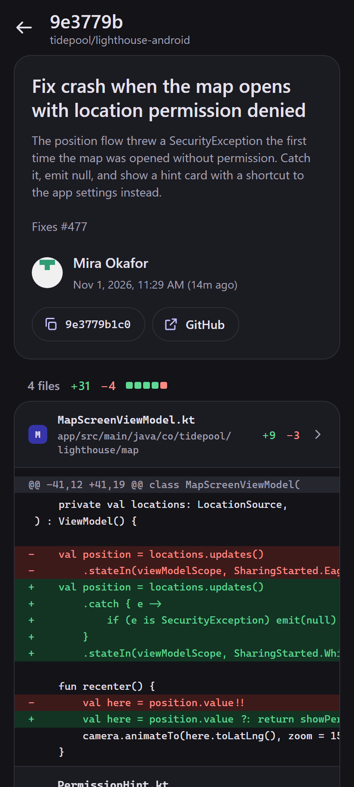

# Commits

A small, read-only GitHub commit browser for your phone. Pick an org, pick a repo, and see what landed today.
No backend, no build step, no tracking: just static files that talk to `api.github.com` with your token.

<p>
  
  
  
</p>

## What it does

- Switch between your organizations and your own account
- Repositories sorted by most recent push, with search and pinning
- Commits grouped by day, with a branch picker and "load older"
- Commit details with expandable, colored diffs
- Installable on Android: pull to refresh, system back gesture, light and dark theme, opens offline
- Optional native Android app with a home screen widget of the newest commits in your pinned repos

## Install on Android

1. Open the app's URL in Chrome (for example `https://<you>.github.io/<repo>/`).
2. Tap **Install** in the top bar, or use Chrome's menu and choose **Add to home screen**, then **Install**.
3. Open **Commits** from your home screen and paste a token (see [Token](#token)).

On iPhone, open the URL in Safari, tap **Share**, then **Add to Home Screen**.

## Android app and widget

Browsers can't put web apps on the home screen as widgets, so [`android/`](android) wraps the same web app
in a small native app and adds a **Pinned commits** widget:

- The newest commits (up to 100) across the repos you starred in the app, newest first
- Each author has their own color: a dot, their name and a soft tint on their commit's card. People shown together never share a color
- Today's commits show relative time, then **Yesterday**, then the date
- With one pinned repo, its name becomes the widget title
- Refreshes every 30 minutes, when you pin or unpin a repo, and with the ↻ button; tap a commit to open it in the app
- Follows your wallpaper colors (Material You) and light/dark mode, and can be resized

There are no prebuilt downloads yet, so build it yourself. You need [Android Studio](https://developer.android.com/studio) (for its JDK and the Android SDK)
and a phone with Android 12 or newer and USB debugging on:

```sh
cd android
export JAVA_HOME="<Android Studio>/jbr"   # e.g. "/c/Program Files/Android/Android Studio/jbr" on Windows
./gradlew assembleDebug
adb install -r app/build/outputs/apk/debug/app-debug.apk
```

Then open **Commits**, paste your token, star the repos you want, and add the widget: long-press the home screen,
choose **Widgets**, then **Commits**.

The build copies the web app from the repo root into the APK, so there's one codebase. The app talks to the widget only
from its own pages, and the widget calls the same GitHub API with the same token. The token is kept in the app's
private storage, which Android doesn't back up.

## Token

Commits needs a GitHub personal access token (classic) with these scopes:

| Scope      | Why                                          |
| ---------- | -------------------------------------------- |
| `repo`     | Read private repositories and their commits  |
| `read:org` | List the organizations you belong to         |

[Create a token with these scopes](https://github.com/settings/tokens/new?scopes=repo,read:org&description=Commits%20app).

If an organization uses SAML single sign-on, its repos won't appear until you authorize the token:
on the [tokens page](https://github.com/settings/tokens), choose **Configure SSO** next to the token, then **Authorize** for that org.

## Privacy

- Your token is stored in your browser's `localStorage` on your device (and, in the Android app, in its private storage for the widget). It is never sent anywhere except `api.github.com`.
- The app makes no other requests besides loading avatar images from `avatars.githubusercontent.com`.
- No analytics, no cookies, no server. The service worker caches only the app's own files, never API responses.
- **Settings → Sign out** deletes the token from the device. You can also revoke it on GitHub at any time.

## Local development

There is nothing to install. Serve the folder and open it:

```sh
python -m http.server 8080
# then open http://localhost:8080
```

The service worker only registers over HTTPS, so local changes show up on reload without cache surprises.
When you change any cached file for a release, bump `CACHE` in [`sw.js`](sw.js) so installed apps pick it up.

| File                   | What it is                                           |
| ---------------------- | ---------------------------------------------------- |
| `index.html`           | App shell and top bar                                |
| `app.js`               | Routing, GitHub API calls and all views              |
| `style.css`            | Theme tokens (light and dark) and components         |
| `sw.js`                | Offline cache for the app shell                      |
| `manifest.webmanifest` | Install metadata: icons, screenshots, colors         |
| `android/`             | Native Android wrapper and home screen widget        |

## Contributing

Bug reports and small, focused pull requests are welcome. Please read [CONTRIBUTING.md](CONTRIBUTING.md) first;
the short version is: keep it simple, keep it dependency-free.

## License

[MIT](LICENSE)
